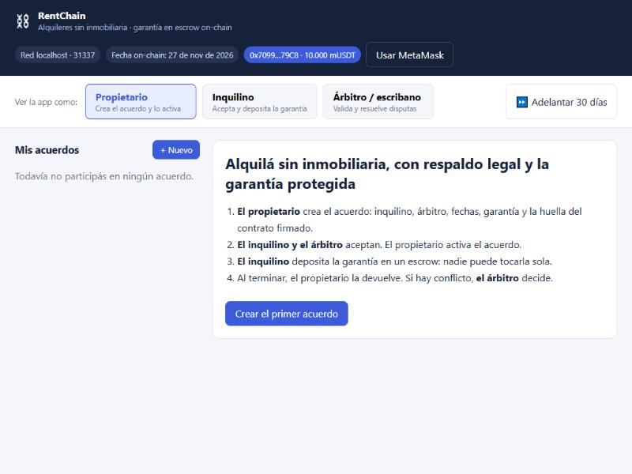
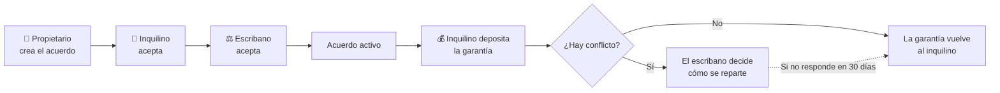
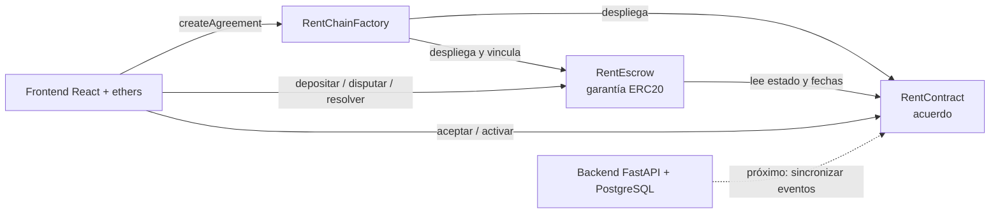
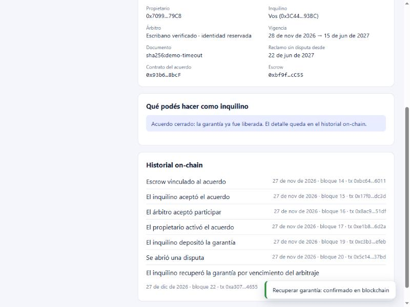

<div align="center">

# 🏠 RentChain

**Alquileres sin inmobiliaria, con la garantía protegida en la blockchain**

[](https://github.com/virginiacastellano/RentChain/actions/workflows/tests.yml)


</div>



## 💡 Mi idea

Alquilar en Argentina es caro e injusto, sobre todo para el inquilino. Cuando alguien se muda tiene que pagar el último mes donde vivía, el depósito del nuevo alquiler, adelantos y además la comisión de la inmobiliaria. Encima, los contratos suelen redactarse a favor de quien los escribe.

Mi idea con RentChain es **sacar a la inmobiliaria del medio y que el contrato sea justo para las dos partes**:

- 🏡 Para **el dueño**, que pone en manos de un desconocido algo que le costó, que pinta y que cuida.
- 🔑 Para **el inquilino**, que hoy carga con casi todos los costos y con contratos que no negoció.

### Cómo lo imagino

1. 👤 **Cada parte tiene su usuario.** El dueño publica la propiedad con todas sus fotos y su estado.
2. 📸 **El inquilino visita el lugar y sube sus propias fotos.** Si lo que muestra el dueño y lo que ve el inquilino no coincide, queda registrado.
3. 📝 **El contrato lo construyen los dos.** El dueño propone una versión y el inquilino sugiere correcciones.
4. ⚖️ **Un escribano matriculado y anónimo revisa todo.** Compara las fotos, evalúa las discrepancias y aprueba el contrato con su criterio profesional. Ninguna de las partes sabe quién es, para que no haya presiones ni extorsiones. La plataforma sí lo conoce y valida que esté matriculado y habilitado; su identidad solo se revela si hay un problema legal.
5. ✍️ **Ambos firman el contrato por la web.** El documento queda en IPFS y su referencia queda sellada en la blockchain: nadie puede modificarlo después.
6. 💰 **Los montos, adelantos y la garantía se manejan con contratos inteligentes**, sin que nadie se quede con la plata en el bolsillo.

### Lo que todavía estoy pensando

- **Sin garantes.** Muchas veces el garante, cuando hay un problema, ya no tiene nada a su nombre y el trámite termina en abogados. Me gustaría reemplazarlo por un **fondo de garantía** o un **seguro de caución** integrado a la plataforma.
- **Qué pasa si el inquilino deja de responder.** Cómo retener parte de la garantía para cubrir gastos de forma justa, sin perjudicar a quien cumple.

### Qué está construido hoy (v1)

La v1 implementa el corazón del sistema, de punta a punta y con interfaz web:

- el **acuerdo** entre dueño, inquilino y escribano, creado en una sola transacción;
- la **garantía en un escrow**, que vuelve al inquilino salvo que el escribano decida otra cosa;
- una **dApp web** donde cada rol ve su estado, sus acciones y el historial on-chain del acuerdo.

Las fotos, la co-redacción del contrato, las firmas web y la subida a IPFS son los siguientes pasos (ver el roadmap).

## ⚙️ Cómo funciona



1. El **propietario** crea el acuerdo con el inquilino, el árbitro, las fechas, el monto de la garantía y la huella del contrato firmado.
2. El **inquilino** y el **árbitro** aceptan participar, y el propietario activa el acuerdo.
3. El inquilino deposita la **garantía** en el escrow.
4. Al terminar el alquiler, el propietario la **devuelve**. Para quedarse con una parte, necesita la autorización del inquilino o abrir una disputa dentro de los **7 días** posteriores. Si no hace nada, el inquilino la recupera.
5. Si hay disputa, el **árbitro** decide: todo para una de las partes o un reparto (por ejemplo, una parte para el propietario por daños y el resto para el inquilino).
6. Si el árbitro no resuelve en **30 días**, la garantía vuelve al inquilino. **La plata nunca queda trabada.**

### Qué puede hacer cada rol

| Rol | Acciones |
|---|---|
| 🏡 **Propietario** | Crear el acuerdo · activarlo cuando todos aceptaron · cancelar el borrador · devolver la garantía · cobrarla solo si el inquilino lo autoriza · abrir disputa |
| 🔑 **Inquilino** | Aceptar el acuerdo · depositar la garantía · autorizar un cobro · abrir disputa · recuperar la garantía si el propietario no responde o si el árbitro no resuelve a tiempo |
| ⚖️ **Escribano / árbitro** | Aceptar participar · resolver la disputa: todo al propietario, todo al inquilino o un reparto |


## 🏗️ Arquitectura



## 📜 Contratos inteligentes

| Contrato | Responsabilidad |
|---|---|
| `RentContract.sol` | El **acuerdo**: participantes, fechas, documento, aceptaciones y estado (`Draft` → `Active` / `Cancelled`). Si cambia el documento, las aceptaciones se invalidan |
| `RentEscrow.sol` | El **dinero**: depósito de la garantía, devolución, disputas, reparto del árbitro y plazos |
| `RentChainFactory.sol` | Crea y **vincula** acuerdo + escrow en una sola transacción y mantiene el índice de acuerdos por participante |
| `MockUSDT.sol` | Token de prueba para el depósito |

Separé el acuerdo del dinero a propósito: cada contrato tiene una sola responsabilidad y es más fácil de auditar.

### 🔐 Decisiones de seguridad

- El escrow se **vincula una sola vez** a su acuerdo y verifica que ambos tengan las mismas personas.
- Solo se puede depositar con el acuerdo **activo**.
- El propietario **no puede llevarse la garantía por su cuenta**: necesita la autorización del inquilino o la decisión del árbitro.
- **Plazos para todo**, así ningún fondo queda bloqueado si alguien desaparece.
- Patrón **Checks-Effects-Interactions**, `SafeERC20` y `ReentrancyGuard` de OpenZeppelin en todas las funciones que mueven fondos.
- Se verifica que llegue el **monto exacto**, para que tokens con comisión no rompan la contabilidad.
- No hay funciones de administrador ni forma de sacar fondos por fuera de estas reglas.
- Cada acción de fondos se ejecuta una sola vez: los tests cubren doble ejecución, transiciones prohibidas y permisos por rol.

> ⚠️ Los contratos **no tienen una auditoría profesional**. Tienen tests propios (ver abajo), pero no deben usarse con fondos reales sin una auditoría independiente.

## 🖥️ Frontend

dApp en **React + Vite + ethers v6**:

- **Modo demo por roles:** se cambia entre Propietario, Inquilino y Escribano con un clic, usando las cuentas locales de Hardhat. No hace falta instalar nada.
- Soporte para **MetaMask** en la red local.
- Solo muestra las acciones que el contrato permite según el **rol** y el **estado** del acuerdo, con un mensaje que explica qué falta.
- **Validación del formulario** con las mismas reglas que el contrato: wallets válidas y distintas, monto mayor a cero, fin posterior al inicio y en el futuro, documento obligatorio.
- **Confirmación previa** de toda acción que mueve fondos o es irreversible, con el monto y el efecto.
- **Estado de cada transacción**: "confirmá en tu wallet" → "esperando confirmación on-chain" (con el hash) → confirmado. Solo informa éxito cuando el recibo on-chain lo confirma.
- **Actualización en vivo**: cada bloque nuevo vuelve a leer el estado, así se ven las acciones de las otras partes sin recargar.
- **Saldos reales**: el saldo de la wallet y el del escrow se leen del token on-chain.
- **Documento verificable**: se registra la huella SHA-256 del PDF y cualquier parte puede verificar que su copia coincide. En borrador, el propietario puede reemplazarlo (las aceptaciones se reinician).
- **Historial on-chain** de cada acuerdo, con el hash de cada transacción (enlace al explorador en redes públicas).
- Botón **⏩ Adelantar 30 días**, solo en la red local de prueba, para probar los plazos.



## 🧩 Backend

API en **FastAPI** con PostgreSQL y SQLAlchemy 2.0, organizada en capas (`routes` → `services` → `repositories`):

- Registro de usuarios con wallet, login con **JWT** y contraseñas con **bcrypt**
- Recuperación de contraseña sin exponer el token y sin revelar qué emails están registrados
- Listado de usuarios solo para administradores
- Modelos para propiedades, acuerdos, participantes, disputas, evidencias y perfiles de árbitro
- Manejo de errores y logging centralizados

## 📁 Estructura

```
blockchain/   contratos, tests, scripts de deploy y demo (Hardhat)
frontend/     dApp en React + ethers
backend/      API en FastAPI
docs/         caso de uso, casos de uso del proyecto, roadmap y capturas
```

## ▶️ Cómo correrlo

**App completa en local** (Node 18+)

```bash
# terminal 1: blockchain local
cd blockchain
npm install
npx hardhat node

# terminal 2: deploy de contratos + configuración del frontend
cd blockchain
npm run deploy:local

# terminal 3: frontend
cd frontend
npm install
npm run dev               # http://localhost:5173
```

### Wallets de prueba (solo red local)

`npm run deploy:local` carga **10.000 mUSDT** en tres cuentas de prueba de Hardhat, que la app usa en modo demo:

| Rol | Wallet |
|---|---|
| Propietario | `0x70997970C51812dc3A010C7d01b50e0d17dc79C8` (cuenta #1) |
| Inquilino | `0x3C44CdDdB6a900fa2b585dd299e03d12FA4293BC` (cuenta #2) |
| Árbitro | `0x90F79bf6EB2c4f870365E785982E1f101E93b906` (cuenta #3) |

Son las cuentas públicas que imprime `npx hardhat node`: **sus claves son conocidas por cualquiera** y nunca deben usarse en una red real. La app no guarda claves; en modo demo firma a través del nodo local.

Para usar **MetaMask**: agregá la red `http://127.0.0.1:8545` (chainId 31337), importá una de esas cuentas y tocá *Usar MetaMask*.

### Contratos en la red local

En un nodo recién iniciado, el deploy siempre produce las mismas direcciones:

| Contrato | Dirección |
|---|---|
| MockUSDT | `0x5FbDB2315678afecb367f032d93F642f64180aa3` |
| RentChainFactory | `0xe7f1725E7734CE288F8367e1Bb143E90bb3F0512` |

Cada acuerdo crea su propio `RentContract` y `RentEscrow`; sus direcciones se ven en la app. Si reiniciás el nodo, corré de nuevo `npm run deploy:local`.

### Comandos

| Comando (en `blockchain/`) | Qué hace |
|---|---|
| `npm test` | Tests de contratos |
| `npm run node` | Nodo local de Hardhat |
| `npm run deploy:local` | Deploy local + configuración del frontend |
| `npm run demo` | Demo por consola en una red en memoria |
| `npm run demo:local` | La misma demo contra el nodo local |
| `npm run deploy:sepolia` | Deploy a testnet (requiere variables de entorno) |

**Demo por consola** (no necesita nodo)

```bash
cd blockchain
npm run demo
```

Recorre tres escenarios: alquiler sin conflicto, disputa resuelta con reparto y acuerdo cancelado. También muestra cómo los contratos bloquean las acciones indebidas.

**Sepolia**

Definí como variables de entorno las de `blockchain/.env.example` y corré `npm run deploy:sepolia`. Si también definís `TENANT_ADDRESS` y `ARBITER_ADDRESS`, se crea un acuerdo de ejemplo.

**Backend** (Python 3.11+ y PostgreSQL)

```bash
cd backend
python -m venv .venv
.venv\Scripts\Activate.ps1     # Windows (en Linux/Mac: source .venv/bin/activate)
pip install -r requirements.txt
cp .env.example .env           # completar DATABASE_URL y JWT_SECRET_KEY
uvicorn app.main:app --reload  # http://localhost:8000/docs
```

## 🧪 Tests

```bash
cd blockchain && npx hardhat test     # 59 tests de contratos
cd backend && python -m pytest        # 18 tests de backend
```

- **Contratos:** acuerdo, factory, depósito, devolución, autorización de cobro, disputas, repartos, plazos, tokens con comisión, control de acceso, doble ejecución, validaciones de entrada, reentrancia y fallos de transacción.
- **Recorridos en el navegador:** verificados manualmente contra el nodo local (ver [`PROJECT_STATUS.md`](PROJECT_STATUS.md)).
- **Backend:** seguridad, autenticación, recuperación de contraseña y permisos.

Corren automáticamente en GitHub Actions con cada cambio.

## ⚠️ Limitaciones conocidas de la v1

El estado detallado (hecho, pendiente, bloqueado y decisiones abiertas) está en [`PROJECT_STATUS.md`](PROJECT_STATUS.md).


- **Documento:** se registra la huella SHA-256; la subida a IPFS es el próximo paso.
- **Escribano anónimo:** la app lo muestra como "identidad reservada", pero su wallet es pública on-chain. Una reserva real requiere una capa de privacidad, como direcciones efímeras o pruebas de conocimiento cero.
- **Elección del escribano:** hoy la hace el propietario y el inquilino la acepta. La asignación aleatoria entre escribanos verificados está en el roadmap.
- **Backend:** todavía no está integrado con la blockchain ni tiene endpoints de acuerdos y disputas (los modelos existen).

## 🗺️ Roadmap

- [x] Contratos de acuerdo y garantía con disputas y plazos
- [x] Factory de contratos: acuerdo + escrow en una transacción
- [x] Frontend con vistas por rol e historial on-chain
- [x] Backend base: usuarios, autenticación y modelos
- [x] Scripts de deploy (local y Sepolia) y demo
- [ ] Endpoints para propiedades, acuerdos y disputas
- [ ] Subida del contrato y de las fotos del dueño y del inquilino a IPFS, y comparación por el escribano
- [ ] Contrato co-redactado: propuesta del dueño y correcciones del inquilino
- [ ] Firma web de ambas partes y aprobación del escribano on-chain
- [ ] Validación de escribanos matriculados y asignación aleatoria (Chainlink VRF)
- [ ] Integración del backend con la blockchain (indexar eventos) y login con wallet (SIWE)
- [ ] Fondo de garantía o seguro de caución para reemplazar a los garantes
- [ ] Posibilidad de reemplazar al escribano

---

<div align="center">

Hecho con 💜 por [Virginia Castellano](https://github.com/virginiacastellano)

</div>
