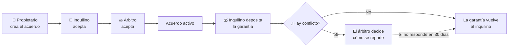

<div align="center">

# 🏠 RentChain

**Alquileres sin inmobiliaria, con la garantía protegida en la blockchain**

[](https://github.com/virginiacastellano/RentChain/actions/workflows/tests.yml)


</div>

## 💡 Mi idea

Alquilar suele depender de una inmobiliaria que cobra comisiones, guarda la garantía y decide cuando hay conflictos. Me pregunté: **¿y si el propietario y el inquilino pudieran hacerlo directamente, sin perder el respaldo legal?**

RentChain es un proyecto personal que nació de esa pregunta. La idea es que **todos salgan ganando**:

- 🏡 **El propietario** inicia el alquiler sin intermediarios y tiene una vía clara para reclamar si hay daños.
- 🔑 **El inquilino** sabe que su garantía no la tiene nadie en el bolsillo: queda guardada en un contrato inteligente y vuelve a él al terminar, salvo que un árbitro decida otra cosa.
- ⚖️ **Un escribano o árbitro verificado** por la plataforma resuelve las disputas. Su identidad real queda reservada frente a las partes, para que pueda decidir sin presiones.

El contrato firmado se guarda en IPFS y su referencia queda registrada en la blockchain: nadie puede modificarlo después.

## ⚙️ Cómo funciona



1. El **propietario** crea el acuerdo con el inquilino, el árbitro, las fechas y el contrato firmado (hash de IPFS).
2. El **inquilino** y el **árbitro** aceptan participar, y el propietario activa el acuerdo.
3. El inquilino deposita la **garantía** en el escrow.
4. Al terminar el alquiler, hay **7 días** para abrir una disputa. Si nadie la abre, la garantía vuelve al inquilino.
5. Si hay disputa, el **árbitro** decide: todo para una de las partes o un reparto (por ejemplo, una parte para el propietario por daños y el resto para el inquilino).
6. Si el árbitro no resuelve en **30 días**, la garantía vuelve al inquilino. **La plata nunca queda trabada.**

## 📜 Contratos inteligentes

| Contrato | Responsabilidad |
|---|---|
| `RentContract.sol` | El **acuerdo**: participantes, fechas, documento en IPFS, aceptaciones y estado (`Draft` → `Active` / `Cancelled`) |
| `RentEscrow.sol` | El **dinero**: depósito de la garantía, devolución, disputas, reparto del árbitro y plazos |
| `MockUSDT.sol` | Token de prueba para el depósito |

Separé el acuerdo del dinero a propósito: cada contrato tiene una sola responsabilidad y es más fácil de auditar.

### 🔐 Decisiones de seguridad

- El escrow se **vincula una sola vez** a su acuerdo y verifica que ambos tengan las mismas personas.
- Solo se puede depositar con el acuerdo **activo**.
- El propietario **no puede llevarse la garantía por su cuenta**: solo el árbitro puede asignarle una parte.
- **Plazos para todo**, así ningún fondo queda bloqueado si alguien desaparece.
- Patrón **Checks-Effects-Interactions** y `SafeERC20` de OpenZeppelin en todas las transferencias.
- Se verifica que llegue el **monto exacto**, para que tokens con comisión no rompan la contabilidad.

## 🧩 Backend

API en **FastAPI** con PostgreSQL y SQLAlchemy 2.0, organizada en capas (`routes` → `services` → `repositories`):

- Registro de usuarios con wallet, login con **JWT** y contraseñas con **bcrypt**
- Recuperación de contraseña
- Modelos para propiedades, acuerdos, participantes, disputas, evidencias y perfiles de árbitro
- Manejo de errores y logging centralizados

## 📁 Estructura

```
blockchain/   contratos, tests y script de deploy (Hardhat)
backend/      API en FastAPI
docs/         caso de uso, casos de uso del proyecto y roadmap
```

## ▶️ Cómo correrlo

**Contratos**

```bash
cd blockchain
npm install
npx hardhat test          # 40 tests
npm run deploy:local      # despliega un escenario completo en la red local
```

Para desplegar en la testnet Sepolia, completá `blockchain/.env.example` como variables de entorno y corré `npm run deploy:sepolia`.

**Backend**

```bash
cd backend
python -m venv .venv
.venv\Scripts\Activate.ps1     # Windows (en Linux/Mac: source .venv/bin/activate)
pip install -r requirements.txt
cp .env.example .env           # completar DATABASE_URL y JWT_SECRET_KEY
uvicorn app.main:app --reload
python -m pytest
```

## 🧪 Tests

- **40 tests de contratos:** acuerdo, depósito, devolución, disputas, repartos, plazos y control de acceso.
- **14 tests de backend:** seguridad, autenticación y endpoints.

Corren automáticamente en GitHub Actions con cada cambio.

## 🗺️ Roadmap

- [x] Contratos de acuerdo y garantía con disputas y plazos
- [x] Backend base: usuarios, autenticación y modelos
- [x] Script de deploy (local y Sepolia)
- [ ] Endpoints para propiedades, acuerdos y disputas
- [ ] Integración del backend con la blockchain (escuchar eventos con web3)
- [ ] Subida real de documentos y evidencias a IPFS
- [ ] Frontend
- [ ] Factory de contratos y posibilidad de reemplazar al árbitro

---

<div align="center">

Hecho con 💜 por [Virginia Castellano](https://github.com/virginiacastellano)

</div>
