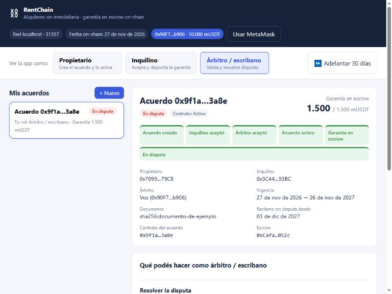
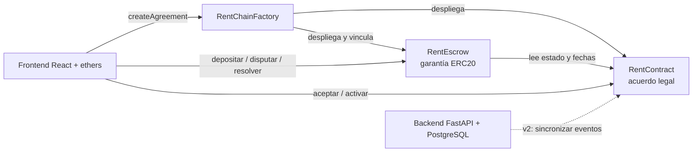

# RentChain

**Alquileres entre particulares, sin inmobiliaria, con la garantía protegida en un escrow on-chain y un escribano verificado como árbitro.**

RentChain reemplaza a la inmobiliaria por tres piezas: un contrato inteligente que registra el acuerdo (partes, fechas y huella del contrato firmado), un escrow que custodia la garantía del inquilino y un árbitro verificado (escribano o tercero de confianza) que resuelve las disputas. Ninguna parte puede quedarse sola con la garantía.


## Qué se puede hacer (v1)

| Rol | Acciones |
|---|---|
| **Propietario** | Crear el acuerdo (inquilino, árbitro, fechas, garantía, huella del documento) · activarlo cuando todos aceptaron · cancelar el borrador · devolver la garantía · cobrarla solo si el inquilino lo autoriza · abrir disputa |
| **Inquilino** | Aceptar el acuerdo · depositar la garantía · autorizar un cobro · abrir disputa · recuperar la garantía si el propietario no responde o si el árbitro no resuelve a tiempo |
| **Árbitro / escribano** | Aceptar participar · resolver la disputa: todo al propietario, todo al inquilino o un reparto |

Todo queda registrado como eventos on-chain y la app muestra el historial de cada acuerdo.



## Arquitectura



| Carpeta | Qué hay |
|---|---|
| `blockchain/` | Contratos Solidity 0.8.20, tests (Hardhat + Chai), scripts de deploy y demo |
| `frontend/` | dApp React + Vite + ethers v6, con modo demo por roles y soporte MetaMask |
| `backend/` | API FastAPI: usuarios, login JWT, recuperación de contraseña, modelo de datos del dominio |
| `docs/` | Caso de uso, casos de uso del proyecto y roadmap del backend |

### Contratos

- **`RentContract`**: el acuerdo legal. Guarda las partes, las fechas y el hash del documento, y pasa por los estados `Draft → Active` o `Draft → Cancelled`. Si el propietario cambia el documento, las aceptaciones previas se invalidan. No mueve dinero.
- **`RentEscrow`**: la garantía en un token ERC20. Reglas:
  - se vincula **una sola vez** a su `RentContract` y verifica que las partes coincidan;
  - solo acepta el depósito si el acuerdo está **activo**;
  - el propietario **no puede cobrar sin autorización** del inquilino; el camino para reclamar daños es la disputa;
  - si el propietario no actúa hasta 7 días después del fin del alquiler, el inquilino **recupera** la garantía;
  - si el árbitro no resuelve en 30 días, la garantía **vuelve al inquilino**, así que los fondos nunca quedan bloqueados.
- **`RentChainFactory`**: crea y vincula el par acuerdo + escrow en **una sola transacción**, y mantiene un índice de acuerdos por participante.

**Seguridad:** todas las transferencias siguen *checks-effects-interactions* y usan `SafeERC20`. Cada función tiene control de acceso por rol y no hay funciones de administrador ni forma de que alguien saque fondos por fuera de las reglas.

## Cómo correrlo

Requisitos: Node 18+ (y Python 3.11+ con PostgreSQL solo para el backend).

```bash
# 1. Blockchain local
cd blockchain
npm install
npx hardhat node                 # deja corriendo la red local (terminal 1)

# 2. Deploy de contratos + configuración del frontend (terminal 2)
cd blockchain
npm run deploy:local

# 3. Frontend (terminal 3)
cd frontend
npm install
npm run dev                      # http://localhost:5173
```

La app arranca en **modo demo**: con los botones *Propietario / Inquilino / Árbitro* cambiás de cuenta (cuentas locales de Hardhat con 10.000 mUSDT cada una) sin instalar nada. El botón **⏩ Adelantar 30 días** simula el paso del tiempo para probar los plazos. También se puede usar **MetaMask** conectado a la red local (chainId 31337).

### Demo por consola

```bash
cd blockchain
npm run demo
```

Recorre tres escenarios: alquiler sin conflicto, disputa resuelta con reparto y acuerdo cancelado. También muestra cómo los contratos bloquean las acciones indebidas.

### Tests

```bash
cd blockchain && npm test                       # 46 tests de contratos
cd backend && python -m pytest                  # 18 tests de la API
```

### Backend (opcional)

```bash
cd backend
python -m venv .venv && .venv\Scripts\activate    # Windows
pip install -r requirements.txt
cp .env.example .env                              # completar DATABASE_URL y JWT_SECRET_KEY
uvicorn app.main:app --reload                     # http://localhost:8000/docs
```

## Estado de la v1

**Funciona**
- Ciclo completo on-chain: crear, aceptar, activar, depositar, devolver o cobrar, disputar, resolver (incluido el reparto) y los timeouts.
- dApp web con vistas por rol, línea de tiempo del acuerdo e historial de eventos on-chain.
- API con registro, login JWT, ruta protegida `/auth/me` y recuperación de contraseña. El token de reseteo no se expone y `/users` es solo para administradores.

**Limitaciones conocidas** (decisiones de alcance de la v1)
- **Documento:** se registra la huella SHA-256 calculada en el navegador; la subida a IPFS queda para la v2.
- **Identidad del árbitro:** la app la muestra como "identidad reservada" frente a las partes, pero su wallet es pública on-chain. Una reserva real requiere una capa de privacidad, como direcciones efímeras o pruebas de conocimiento cero.
- **Árbitro:** lo elige el propietario y el inquilino lo acepta. La asignación aleatoria entre escribanos verificados está en el roadmap.
- **Backend:** todavía no tiene endpoints para propiedades, acuerdos ni disputas (los modelos existen), ni está integrado con la blockchain.
- **Token:** se usa `MockUSDT` en local. No hay deploy público todavía; `hardhat.config.js` ya admite Sepolia vía variables de entorno.

## Roadmap

1. Subida del contrato a IPFS y verificación de la huella on-chain.
2. Endpoints de acuerdos, disputas y evidencias, más un indexador de eventos on-chain en el backend.
3. Registro de escribanos verificados y asignación aleatoria del árbitro (Chainlink VRF).
4. Deploy en Sepolia con USDC de testnet y verificación en Etherscan.
5. Login con wallet (SIWE) que vincule la cuenta de la API con la wallet.


## Stack

Solidity 0.8.20 · OpenZeppelin · Hardhat · Chai · React 19 · Vite · ethers v6 · FastAPI · SQLAlchemy 2 · PostgreSQL · JWT · pytest
