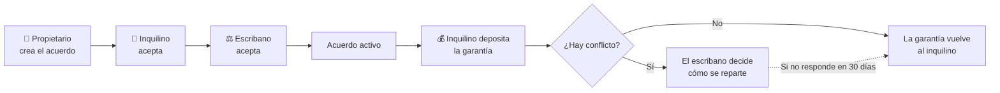

<div align="center">

# 🏠 RentChain

**Alquileres sin inmobiliaria, con la garantía protegida en la blockchain**

[](https://github.com/virginiacastellano/RentChain/actions/workflows/tests.yml)


</div>

## 💡 Mi idea

Alquilar en Argentina es caro e injusto, sobre todo para el inquilino. Cuando alguien se muda tiene que pagar el último mes donde vivía, el depósito del nuevo alquiler, adelantos y además la comisión de la inmobiliaria. Encima, los contratos suelen redactarse a favor de quien los escribe.

Mi idea con RentChain es **sacar a la inmobiliaria del medio y que el contrato sea justo para las dos partes**:

- 🏡 Para **el dueño**, que pone en manos de un desconocido algo que le costó, que pinta y que cuida.
- 🔑 Para **el inquilino**, que hoy carga con casi todos los costos y con contratos que no negoció.

### Cómo lo imagino

1. 👤 **Cada parte tiene su usuario.** El dueño publica la propiedad con todas sus fotos y su estado.
2. 📸 **El inquilino visita el lugar y sube sus propias fotos.** Si lo que muestra el dueño y lo que ve el inquilino no coincide, queda registrado.
3. 📝 **El contrato lo construyen los dos.** El dueño propone una versión y el inquilino sugiere correcciones.
4. ⚖️ **Un escribano matriculado y anónimo revisa todo.** Compara las fotos, evalúa las discrepancias y aprueba el contrato con su criterio profesional. Ninguna de las partes sabe quién es, para que no haya presiones ni extorsiones. La plataforma sí lo conoce y valida que esté matriculado y habilitado; su identidad solo se revela si hay un problema legal.
5. ✍️ **Ambos firman el contrato por la web.** El documento queda en IPFS y su referencia queda sellada en la blockchain: nadie puede modificarlo después.
6. 💰 **Los montos, adelantos y la garantía se manejan con contratos inteligentes**, sin que nadie se quede con la plata en el bolsillo.

### Lo que todavía estoy pensando

- **Sin garantes.** Muchas veces el garante, cuando hay un problema, ya no tiene nada a su nombre y el trámite termina en abogados. Me gustaría reemplazarlo por un **fondo de garantía** o un **seguro de caución** integrado a la plataforma.
- **Qué pasa si el inquilino deja de responder.** Cómo retener parte de la garantía para cubrir gastos de forma justa, sin perjudicar a quien cumple.

### Qué está construido hoy

La primera versión implementa el corazón del sistema: el **acuerdo** entre dueño, inquilino y escribano, y la **garantía en un escrow** que el escribano resuelve si hay conflicto. Las fotos, la co-redacción del contrato y las firmas web son los siguientes pasos (ver el roadmap).

## ⚙️ Cómo funciona



1. El **propietario** crea el acuerdo con el inquilino, el árbitro, las fechas y el contrato firmado (hash de IPFS).
2. El **inquilino** y el **árbitro** aceptan participar, y el propietario activa el acuerdo.
3. El inquilino deposita la **garantía** en el escrow.
4. Al terminar el alquiler, hay **7 días** para abrir una disputa. Si nadie la abre, la garantía vuelve al inquilino.
5. Si hay disputa, el **árbitro** decide: todo para una de las partes o un reparto (por ejemplo, una parte para el propietario por daños y el resto para el inquilino).
6. Si el árbitro no resuelve en **30 días**, la garantía vuelve al inquilino. **La plata nunca queda trabada.**

## 📜 Contratos inteligentes

| Contrato | Responsabilidad |
|---|---|
| `RentContract.sol` | El **acuerdo**: participantes, fechas, documento en IPFS, aceptaciones y estado (`Draft` → `Active` / `Cancelled`) |
| `RentEscrow.sol` | El **dinero**: depósito de la garantía, devolución, disputas, reparto del árbitro y plazos |
| `MockUSDT.sol` | Token de prueba para el depósito |

Separé el acuerdo del dinero a propósito: cada contrato tiene una sola responsabilidad y es más fácil de auditar.

### 🔐 Decisiones de seguridad

- El escrow se **vincula una sola vez** a su acuerdo y verifica que ambos tengan las mismas personas.
- Solo se puede depositar con el acuerdo **activo**.
- El propietario **no puede llevarse la garantía por su cuenta**: solo el árbitro puede asignarle una parte.
- **Plazos para todo**, así ningún fondo queda bloqueado si alguien desaparece.
- Patrón **Checks-Effects-Interactions** y `SafeERC20` de OpenZeppelin en todas las transferencias.
- Se verifica que llegue el **monto exacto**, para que tokens con comisión no rompan la contabilidad.

## 🧩 Backend

API en **FastAPI** con PostgreSQL y SQLAlchemy 2.0, organizada en capas (`routes` → `services` → `repositories`):

- Registro de usuarios con wallet, login con **JWT** y contraseñas con **bcrypt**
- Recuperación de contraseña
- Modelos para propiedades, acuerdos, participantes, disputas, evidencias y perfiles de árbitro
- Manejo de errores y logging centralizados

## 📁 Estructura

```
blockchain/   contratos, tests y script de deploy (Hardhat)
backend/      API en FastAPI
docs/         caso de uso, casos de uso del proyecto y roadmap
```

## ▶️ Cómo correrlo

**Contratos**

```bash
cd blockchain
npm install
npx hardhat test          # 40 tests
npm run deploy:local      # despliega un escenario completo en la red local
```

Para desplegar en la testnet Sepolia, completá `blockchain/.env.example` como variables de entorno y corré `npm run deploy:sepolia`.

**Backend**

```bash
cd backend
python -m venv .venv
.venv\Scripts\Activate.ps1     # Windows (en Linux/Mac: source .venv/bin/activate)
pip install -r requirements.txt
cp .env.example .env           # completar DATABASE_URL y JWT_SECRET_KEY
uvicorn app.main:app --reload
python -m pytest
```

## 🧪 Tests

- **40 tests de contratos:** acuerdo, depósito, devolución, disputas, repartos, plazos y control de acceso.
- **14 tests de backend:** seguridad, autenticación y endpoints.

Corren automáticamente en GitHub Actions con cada cambio.

## 🗺️ Roadmap

- [x] Contratos de acuerdo y garantía con disputas y plazos
- [x] Backend base: usuarios, autenticación y modelos
- [x] Script de deploy (local y Sepolia)
- [ ] Endpoints para propiedades, acuerdos y disputas
- [ ] Subida de fotos del dueño y del inquilino a IPFS, y comparación por el escribano
- [ ] Contrato co-redactado: propuesta del dueño y correcciones del inquilino
- [ ] Firma web de ambas partes y aprobación del escribano on-chain
- [ ] Validación de escribanos matriculados
- [ ] Integración del backend con la blockchain (escuchar eventos con web3)
- [ ] Fondo de garantía o seguro de caución para reemplazar a los garantes
- [ ] Frontend
- [ ] Factory de contratos y posibilidad de reemplazar al escribano

---

<div align="center">

Hecho con 💜 por [Virginia Castellano](https://github.com/virginiacastellano)

</div>
